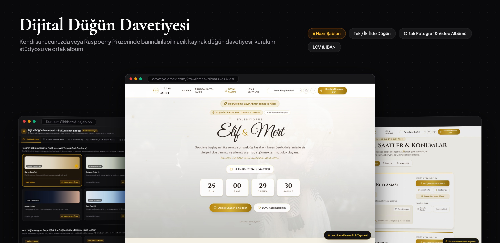
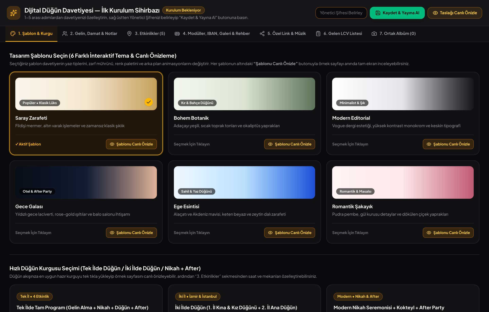
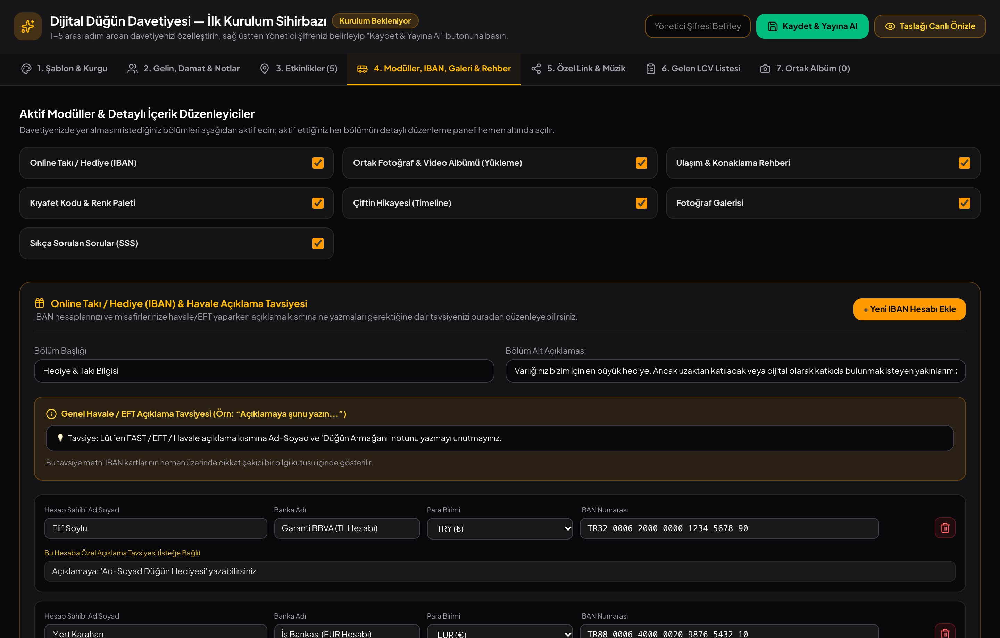
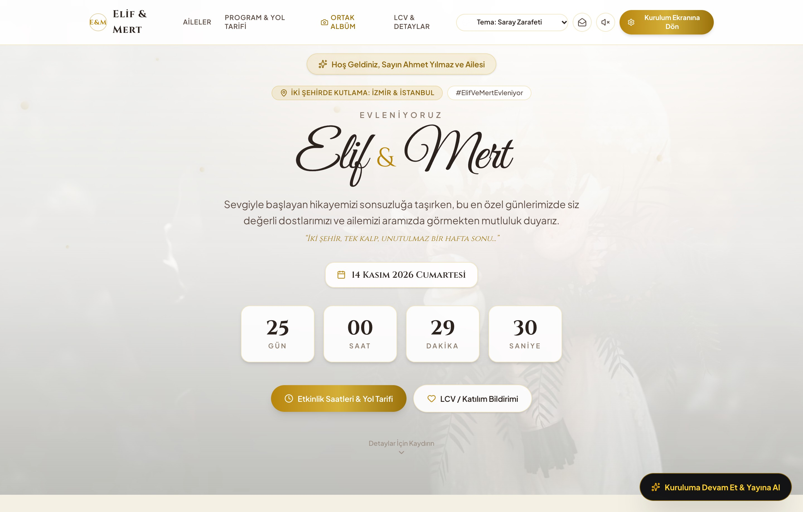
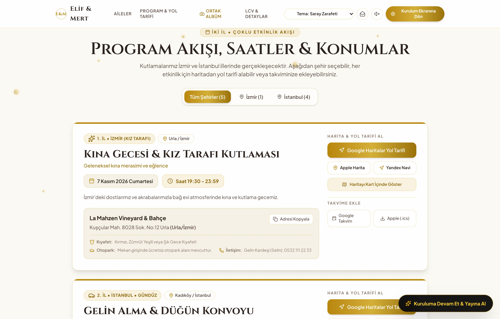
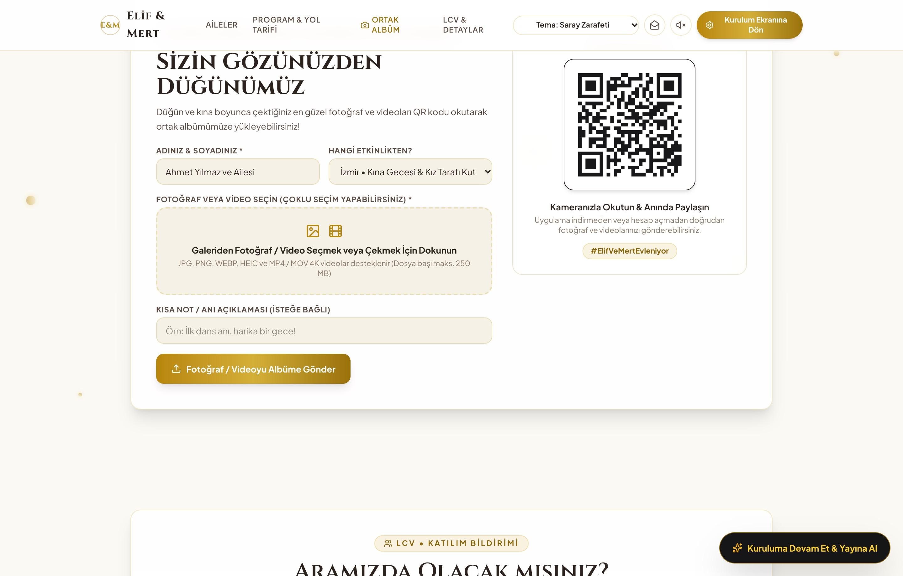
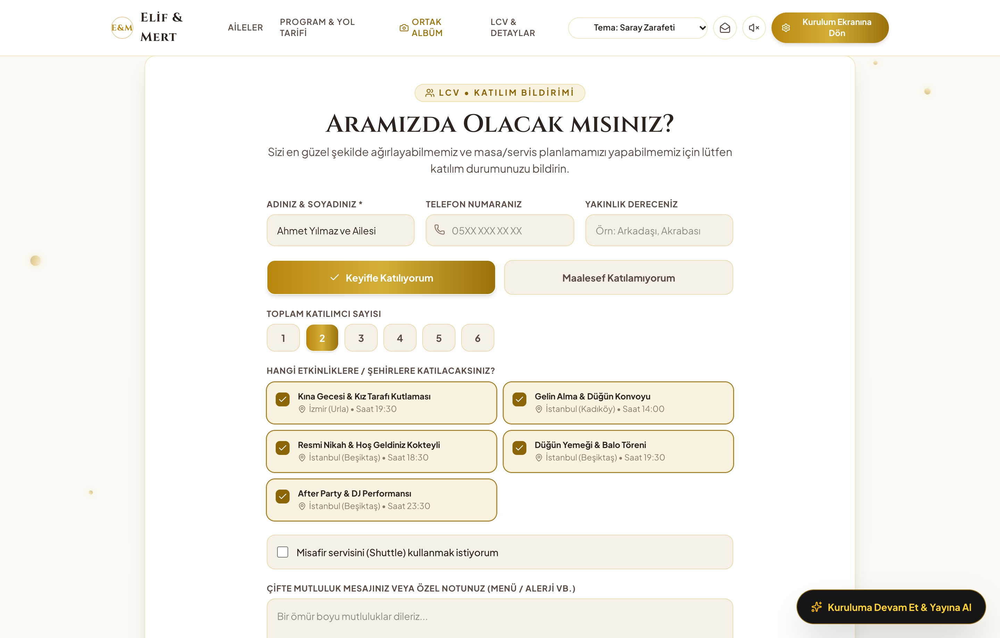
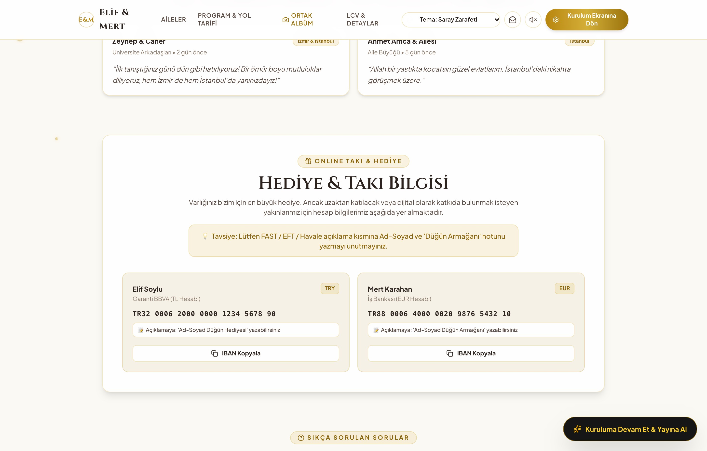

# Dijital Düğün Davetiyesi

Kendi bilgisayarınızda, sunucunuzda veya Raspberry Pi üzerinde barındırabileceğiniz açık kaynaklı dijital düğün davetiyesi uygulaması. 

Kurulum sırasında kod yazmanıza veya JSON dosyası düzenlemenize gerek yoktur; uygulama ilk açıldığında doğrudan **Kurulum Sihirbazı** ile başlar. Tarayıcı üzerinden şablonu, gelin-damat bilgilerini, etkinlik saat/konumlarını, IBAN bilgilerini ve ortak albüm ayarlarını yapıp **Yönetici Şifresi** belirleyerek kaydettiğinizde site yayına hazır hale gelir.

---

## Özellikler

- **Tarayıcı Üzerinden Kurulum Stüdyosu:** Uygulama ilk kez çalıştırıldığında kurulum ekranı açılır. Ayarları kaydedip yönetici şifresi belirlediğinizde düzenleme paneli misafirlere kapanır.
- **6 Farklı Tema:** Saray Zarafeti, Bohem Botanik, Modern Editorial, Gece Galası, Ege Esintisi ve Romantik Şakayık. Her şablon kurulum ekranından canlı önizlenebilir.
- **Tek İl veya İki İlde Düğün Kurgusu:** Kız isteme, nişan, kına gecesi, gelin alma, resmi nikah, düğün yemeği ve after party gibi istediğiniz kadar etkinliği farklı şehir ve saatlerle ekleyebilirsiniz.
- **Harita ve Takvim Entegrasyonu:** Her etkinlik için Google Haritalar, Apple Harita ve Yandex Navigasyon yol tarifi bağlantıları ile Google/Apple Takvim (`.ics`) dosyası otomatik oluşturulur.
- **Moderasyonlu Ortak Fotoğraf & Video Albümü (QR Kodlu):** Misafirler üye olmadan veya uygulama indirmeden QR kodu okutup fotoğraf ve videolarını (dosya başı 250 MB'a kadar) doğrudan sunucunuza yükleyebilir.
  - **Yönetici Onaylı Gösterim:** Yüklenen fotoğraf/videolar siz yönetici panelinden onaylayana kadar sayfada görünmez.
  - **Tam Gizli Arşiv Modu:** İsterseniz yüklenen dosyalar sadece sunucunuzdaki `uploads/` klasörüne kaydedilir, sayfada hiç gösterilmez.
  - **Masa PIN Kodu:** İsteğe bağlı şifre belirleyerek sadece düğün salonundaki davetlilerin dosya yüklemesini sağlayabilirsiniz.
- **Online Takı / IBAN ve LCV Formu:** Tek tıkla kopyalanabilir IBAN kartları (Havale/EFT açıklama tavsiyesi notu ile birlikte) ve Excel/CSV çıktısı alınabilen LCV katılım formu.
- **İsme Özel Davetli Linki:** `?to=Ahmet%20Yılmaz%20ve%20Ailesi` parametresiyle gönderilen linklerde davetiye misafirin kendi adıyla açılır.

---

## Uygulama Ekran Görüntüleri

### Kurulum Sihirbazı ve Şablon Seçimi


### Modül, IBAN ve Ortak Albüm Ayarları


### Karşılama Ekranı ve Geri Sayım


### Etkinlik Programı, Şehir Filtresi ve Yol Tarifi


### Ortak Fotoğraf & Video Albümü (QR Kod)


### LCV Katılım Formu ve IBAN Hediye Kartları
| LCV (Katılım Bildirimi) Formu | Online Takı / Hediye (IBAN) |
| :---: | :---: |
|  |  |

---

## Kurulum ve Çalıştırma

Gereksinimler: **Node.js 18+** (Node 20 veya 22 önerilir).

```bash
git clone https://github.com/gorkemguler/dijital-dugun-davetiyesi.git
cd dijital-dugun-davetiyesi

npm install
npm run build
npm start
```

Sunucu varsayılan olarak `http://localhost:4173` portunda çalışır.

1. Tarayıcıdan `http://localhost:4173` adresine girin.
2. Kurulum ekranındaki sekmelerden davetiye bilgilerinizi girin.
3. Sağ üstteki alana en az 4 karakterli bir **Yönetici Şifresi** yazıp **Kaydet & Yayına Al** butonuna tıklayın.

Daha sonra ayarları tekrar düzenlemek, gelen LCV listesini görmek veya yüklenen fotoğrafları onaylamak için sayfanın en altındaki **Yönetici** bağlantısına tıklayabilir ya da `http://localhost:4173/?yonetim=1` adresine gidebilirsiniz.

---

## Cloudflare Tunnel ile Yayına Alma

Modemde port açmadan (Port Forwarding yapmadan) davetiyeyi dış dünyaya açmak için `cloudflared` kullanabilirsiniz:

**Hızlı geçici link ile test etmek için:**
```bash
cloudflared tunnel --url http://localhost:4173
```

**Kendi alan adınızla kalıcı yayın için:**
```bash
cloudflared tunnel login
cloudflared tunnel create dugun-davet
cloudflared tunnel route dns dugun-davet dugun.alanadiniz.com
cloudflared tunnel run --url http://localhost:4173 dugun-davet
```

---

## Raspberry Pi 4B (2GB RAM / 64GB SD Kart) Notları

- **Bellek Kullanımı:** Yüklenen fotoğraf ve videolar RAM'de tutulmaz; doğrudan `fs.createWriteStream` ile diske yazılır. 2 GB RAM'li Raspberry Pi 4B üzerinde Node.js süreci ortalama 50–65 MB RAM tüketir.
- **Depolama Kotası:** 64 GB SD kartın yalnızca bu projeye ayrıldığı senaryoya göre varsayılan albüm kotası **50 GB** ve maksimum medya sayısı **10.000 adet** (dosya başı maks. 250 MB) olarak ayarlanmıştır. Bu sınırları Kurulum Stüdyosu içindeki **4. Modüller, IBAN, Galeri & Rehber** sekmesinden değiştirebilirsiniz.
- **Dosya Güvenliği:** Yüklenen dosyaların yalnızca uzantısına değil, ilk 16 byte'lık dosya imzasına (Magic Bytes) bakılır; geçerli bir fotoğraf veya video imzası taşımayan dosyalar reddedilir.

---

## Dosya ve Veri Yapısı

Çalışma zamanında oluşan kişisel veriler ve yüklenen dosyalar `.gitignore` içindedir, Git'e dahil edilmez:

- `src/data/weddingConfig.json` — Davetiye ayarları
- `data/adminAuth.json` — `scrypt` ile özetlenmiş yönetici şifresi
- `data/rsvpSubmissions.json` — LCV katılım kayıtları
- `data/guestNotes.json` — Anı duvarı mesajları
- `data/albumMedia.json` — Ortak albüm medya kayıtları ve onay durumları
- `uploads/` — Yüklenen fotoğraf ve videolar
